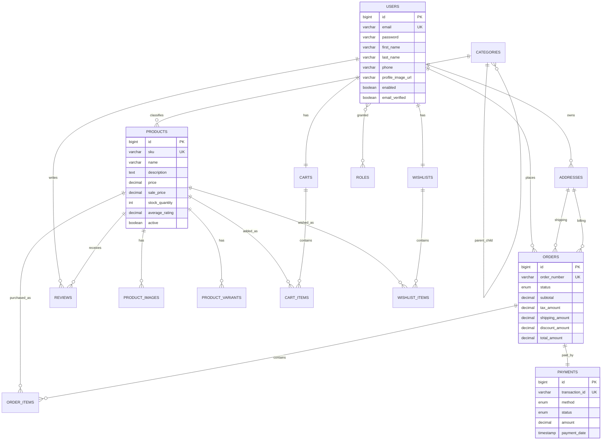

# SwiftCart ER Diagram

Relationship coverage:

- One-to-one: `User -> Cart`, `User -> Wishlist`, `Order -> Payment`
- One-to-many: `Category -> Product`, `Product -> ProductImage`, `Order -> OrderItem`
- Many-to-one: `Order -> User`, `Product -> Category`, `Review -> Product`
- Many-to-many: `User <-> Role`
